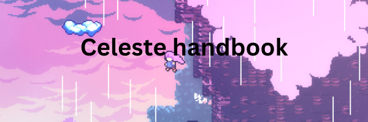

# Celeste Handbook

The goal of this website is to provide a useful source for players trying to complete Celeste. The handbook provides information about each chapter, explaining the obstacles players encounter and how the different gameplay mechanics work.

## Key Features

- Chapter guides: Info about the different chapters and their mechanics.
- Obstacle descriptsion: Explanations of obcstacles and their functions.
- Logical navigation: A structured layout for easy navigation between chapters.

## Used Technologies 

- HTML5
- CSS3
- JavaScript

## Contributors 

- Otto
- Jürmo 
- Erlend

## Division of labor

- Otto: README file and chapters 2-5
- Jürmo: Home page, chapter template, chapter 1 and JavaScript
- Erlend: Created a document with all the information about the contents of the chapters and chapters 6-9

## Sources and Credits

- Celeste – Original game and gameplay assets.
- [BerryCamp](https://berrycamp.github.io/) – Chapter maps
  and obstacle images.

This project is an unofficial fan-made handbook and is
not affiliated with the developers of Celeste.