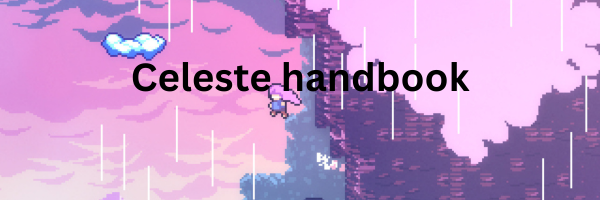

# Celeste Handbook

The goal of this website is to provide a useful source for players trying to complete Celeste. The handbook provides information about each chapter, explaining the obstacles players encounter and how the different gameplay mechanics work.

## Key Features

- Chapter guides: Info about the different chapters and their mechanics.
- Obstacle descriptsion: Exlanations of obcstacles and their functions.
- Logical navigation: A structured layout for easy navigation between chapters.

## How To Use

1. ...

## Used Technologies 

- HTML5
- CSS3
- Javascript

## Contributors 

- Otto
- Jürmo 
- Erlend